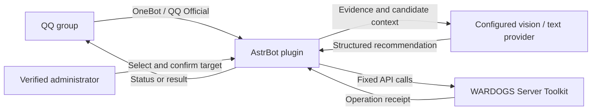

# AstrBot WARDOGS Archive

[简体中文](README.zh-CN.md) · [Configuration and usage](docs/SETUP.md) · [AI workflow](AGENTS.md)

An archived AstrBot plugin that connects QQ group reports and administrator commands to a self-hosted WARDOGS management service. It collects available report evidence, proposes a moderation decision, and routes permitted actions through fixed backend endpoints. The original server has shut down and this repository is unmaintained.

## Get started

1. Set up the [WARDOGS Server Toolkit](https://github.com/RhoninSeiei/wardogs-server-toolkit) and a compatible AstrBot installation. The plugin metadata declares AstrBot 4.28.2 or later in the 4.x series.
2. Install this repository through AstrBot's plugin installer. For a manual installation, use the directory name `astrbot_plugin_wardogs` in AstrBot's configured plugin directory, install `requirements.txt` in its Python environment, and load the plugin.
3. Set `service_base`, the token file path and the exact bot and group scope. Start with read-only queries and keep `auto_execute` disabled. Use the [setup checklist](docs/SETUP.md) before opting into writes.
4. For screenshot review, select a vision-capable provider configured in your AstrBot instance.

Licensed under [AGPL-3.0](LICENSE). This snapshot contains no original deployment logs, screenshots, credentials or private repository history.
