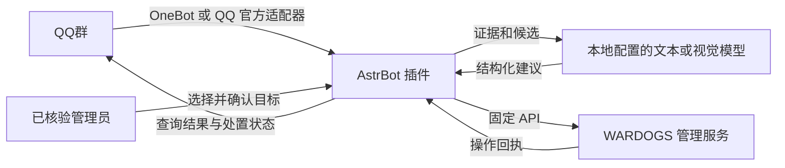

# AstrBot WARDOGS 管理插件

[English](README.md) · [配置与使用](docs/SETUP.md) · [AI 接入流程](AGENTS.md)

将 QQ 群聊举报、证据核验和管理员指令接入自托管 WARDOGS 管理服务。插件支持 OneBot 与 QQ 官方适配器，通过固定 API 读取状态、提交明确授权的操作并查询回执。原服务器已关闭，仓库随公开归档，后续不再维护。

先部署 [管理后端](https://github.com/RhoninSeiei/wardogs-server-toolkit)，通过 AstrBot 插件安装器导入本仓库。手动安装时目录名使用 `astrbot_plugin_wardogs`，依赖须安装在 AstrBot 自身的 Python 环境。填入后端地址、凭据文件路径、实际机器人和群范围，先用只读命令验证，再根据需要启用管理写入。截图审核需要可用的视觉模型。兼容版本见 `metadata.yaml`。

详细步骤见 [配置与使用](docs/SETUP.md)。源码采用 [AGPL-3.0](LICENSE)。
